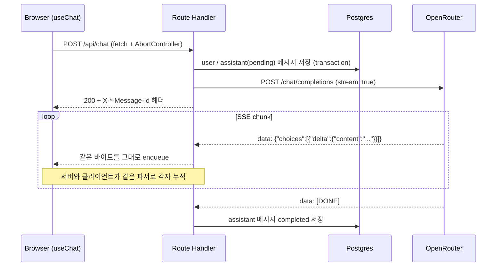
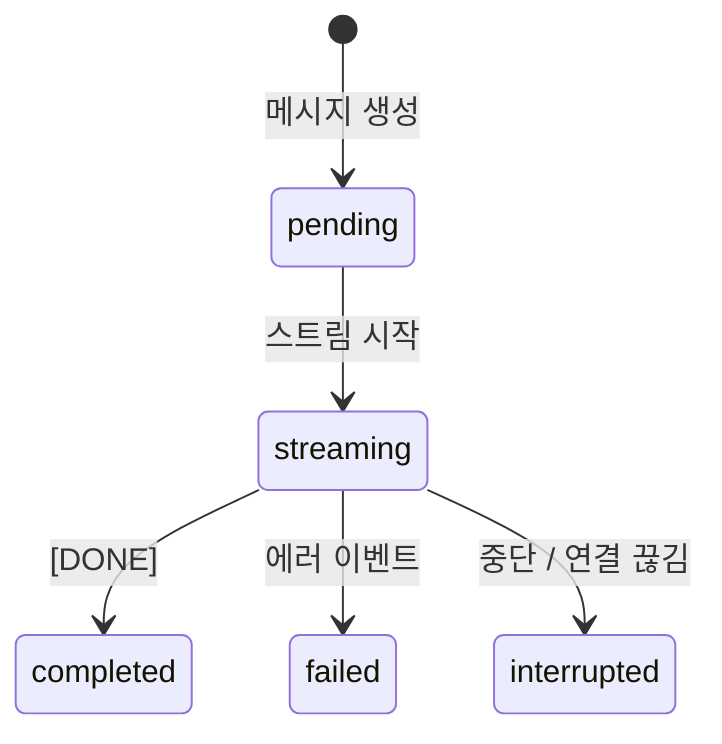

# AI Chat

LLM 응답을 SSE(Server-Sent Events)로 실시간 스트리밍하는 채팅 앱입니다.
서버가 OpenRouter의 SSE 스트림을 브라우저로 그대로 중계하면서, 같은 스트림을 파싱해 응답을 DB에 저장합니다.

**Demo:** https://ai-chat-xi-six-54.vercel.app

## 스트리밍 구조



## 구현 포인트

### 1. chunk 경계와 이벤트 경계가 다를 때의 파싱

네트워크 chunk와 SSE 이벤트의 경계는 서로 독립적입니다. 이벤트 하나가 두 chunk에 걸치거나, chunk 하나에 이벤트 여러 개가 담겨 올 수 있습니다.
[`openrouterSse.ts`](src/lib/openrouterSse.ts)는 buffer를 두고 빈 줄(`\n\n`) 기준으로 완성된 이벤트만 꺼내고, 끝에 남은 미완성 조각은 다음 chunk와 합칩니다.

```ts
state.buffer += chunk;
const events = state.buffer.split(/\r?\n\r?\n/);
state.buffer = events.pop() ?? ''; // 미완성 이벤트는 다음 chunk로
```

- `[DONE]`으로 정상 종료를, 스트림 중간의 `error` 객체나 `finish_reason: "error"`로 실패를 구분합니다.
- `TextDecoder`를 `{ stream: true }`로 사용해 chunk 사이에 걸친 멀티바이트 문자(한글)도 온전하게 복원합니다.
- 이 파서 하나를 서버와 클라이언트가 함께 씁니다.

### 2. 중계하면서 저장하기

[`streamAssistantResponse.ts`](src/lib/server/streamAssistantResponse.ts)는 upstream 응답을 `ReadableStream`으로 감싸, 받은 바이트를 브라우저로 바로 흘려보내는 동시에 파싱해서 본문을 누적합니다.
스트림이 끝나는 방식에 따라 최종 상태를 한 번만 DB에 기록합니다.

| 종료 방식 | 저장되는 상태 |
| --- | --- |
| `[DONE]` 수신 | `completed` |
| 스트림 안의 에러 이벤트, 네트워크 오류 | `failed` |
| 사용자가 중단, 브라우저 연결 끊김 | `interrupted` (그때까지 받은 내용 보존) |



### 3. 중단(Abort) 전파

브라우저의 중단 요청이 OpenRouter 호출까지 이어지도록 signal을 끝까지 전달합니다.

1. 클라이언트: `AbortController.abort()`로 `fetch`를 중단합니다.
2. 서버: Route Handler의 `request.signal`을 OpenRouter `fetch`에 그대로 넘겨 upstream 요청도 함께 취소합니다.
3. 스트림의 `cancel()`에서 upstream reader를 정리하고, 최종 상태가 기록되기 전이라면 `interrupted`로 저장합니다.

중단 즉시 모델 호출까지 함께 정리되고, 그때까지 받은 응답은 그대로 보존됩니다.

### 4. 스트림 본문과 메타데이터 분리

응답 본문은 OpenRouter의 SSE를 그대로 전달하므로, 서버가 만든 메시지 id와 생성 시각은 응답 헤더(`X-User-Message-Id`, `X-Assistant-Message-Id` 등)로 보냅니다.
클라이언트는 전송 즉시 임시 id로 optimistic 메시지를 그리고, 헤더를 받는 순간 실제 DB id로 교체합니다. 덕분에 스트리밍이 끝나자마자 재생성·삭제가 실제 DB 레코드를 정확히 가리킵니다.

대화 내용을 POST body로 함께 보내기 위해 `EventSource` 대신 `fetch` + `response.body.getReader()`로 SSE를 직접 읽습니다.

### 5. 트랜잭션은 짧게, 스트리밍은 밖에서

메시지 저장은 짧은 Prisma interactive transaction으로 끝내고, 수 초에서 수십 초가 걸리는 스트리밍은 transaction 밖에서 실행합니다. DB 커넥션은 저장이 필요한 순간에만 짧게 사용합니다.

## 그 밖의 기능

- 대화 생성, 선택, 삭제, 이어서 채팅
- assistant 응답 재생성 및 재시도
- Markdown 및 코드 블록 하이라이팅
- 한국어 IME 조합 입력을 고려한 Enter 전송 처리
- 모바일 sidebar drawer, 데스크톱 sidebar 접기/펼치기
- API key는 서버 Route Handler에서만 사용하는 서버 전용 구성

## Tech Stack

| 영역 | 사용 기술 |
| --- | --- |
| Framework | Next.js 16 App Router, React 19, TypeScript |
| 스타일 | Tailwind CSS v4 |
| 서버 상태 | TanStack Query |
| DB | Prisma 7, Neon Postgres (`@prisma/adapter-neon`) |
| LLM | OpenRouter Chat Completions API (streaming) |
| 배포 | Vercel |

## Project Structure

```txt
src/
  app/api/chat/route.ts           # 메시지 저장 → OpenRouter 호출 → 스트림 응답
  app/api/conversations/          # 대화 목록/상세/삭제, 응답 재생성
  hooks/useChat.ts                # 전송·중단·재생성, 클라이언트 스트림 소비
  hooks/useConversations.ts       # TanStack Query 기반 대화 서버 상태
  lib/openrouterSse.ts            # 서버·클라이언트 공용 SSE 파서
  lib/server/
    streamAssistantResponse.ts    # 스트림 중계 + 누적 + 최종 상태 저장
    openrouter.ts                 # OpenRouter 호출, 에러 코드 → 사용자 메시지 변환
    prisma.ts                     # Neon adapter 기반 Prisma Client
  components/chat/                # 채팅 화면, sidebar, 메시지 UI
prisma/schema.prisma              # Conversation / Message (status: pending → streaming → completed | failed | interrupted)
```
